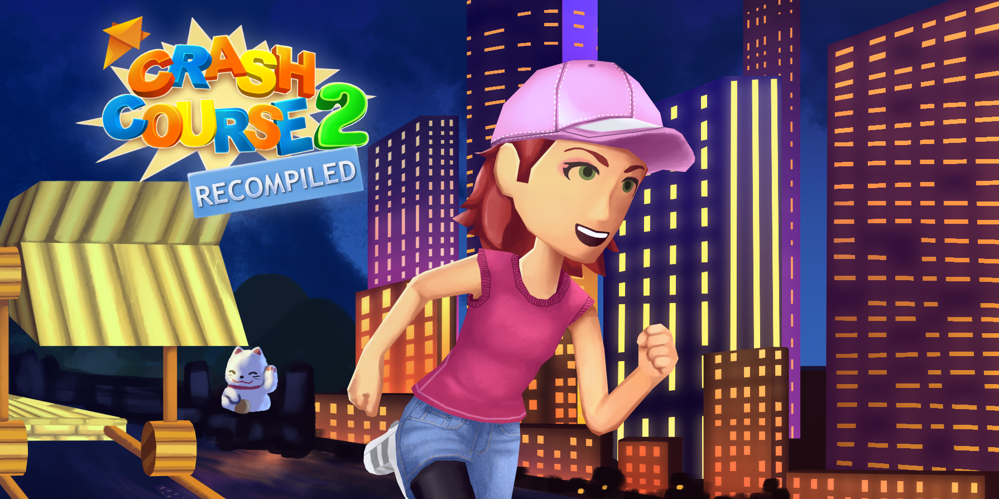

  

# Crash Course 2: Recompiled

An unofficial PC port of Doritos Crash Course 2 created through static recompilation using the [ReXGlue SDK](https://github.com/rexglue/rexglue-sdk).

This project doesn't include the game or assets. 

## Features

- Hong Kong DLC
- Online multiplayer
- Avatars from the [Avatar Editor Recomp](https://github.com/panedivitasei/AvatarEditorRecomp)
- Native D3D12 renderer

Settings are in the Help & Options menu and `crashcourse2.toml`. 

Save data is located in `Documents\JMstudios\userdata\Crash Course 2`.

## Building

See [BUILDING.md](BUILDING.md).

## Credits

- [ReXGlue SDK](https://github.com/rexglue/rexglue-sdk)
- [Xenia](https://xenia.jp)
- [UnleashedRecomp](https://github.com/hedge-dev/UnleashedRecomp)
- [XenosRecomp](https://github.com/hedge-dev/XenosRecomp)
- [plume](https://github.com/renderbag/plume)
- [RexLiveless](https://github.com/SolarCookies/RexLiveless)
